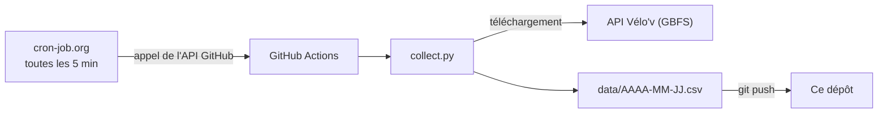

# Vélo'v Lyon : prévoir et rééquilibrer les stations

Collecter en continu l'état des stations Vélo'v de Lyon, prévoir celles qui vont se retrouver vides ou pleines, puis calculer les tournées de camions qui les rééquilibrent.

> **État du projet** : la collecte automatique tourne depuis novembre 2026. La prédiction, l'optimisation et la carte sont les prochaines étapes.

## Le problème

Vélo'v compte plus de 400 stations et 5 000 vélos dans la Métropole de Lyon ([source](https://www.data.gouv.fr/datasets/stations-velov-de-la-metropole-de-lyon/informations)). Les trajets ne sont pas équilibrés : le matin, les flux vont des quartiers d'habitation vers les zones de travail, le soir c'est l'inverse, et sur les collines on descend volontiers à vélo mais on remonte rarement.

Résultat, deux échecs pour l'usager :

- **la station vide** : pas de vélo à prendre ;
- **la station pleine** : impossible de déposer son vélo.

L'opérateur déplace des vélos en camion pour compenser, mais les camions sont peu nombreux et coûteux ([Lyon Capitale, juillet 2025](https://www.lyoncapitale.fr/actualite/velo-v-a-lyon-100-000-abonnes-de-nouvelles-stations-et-quelques-questions)). Attendre qu'une station soit vide pour intervenir, c'est déjà trop tard : il faut **anticiper**.

**Question du projet** : avec un nombre limité de camions, quelles stations faut-il remplir ou vider, et dans quel ordre, pour minimiser le nombre d'usagers qui trouveront une station vide ou pleine dans les prochaines heures ?

## Les quatre briques

| Brique | Rôle | État |
| --- | --- | --- |
| 1. Collecte | Photographier l'état de toutes les stations toutes les 5 minutes | Terminée |
| 2. Prédiction | Prévoir le nombre de vélos de chaque station dans 1 heure | À venir |
| 3. Optimisation | Calculer les tournées de rééquilibrage (recherche opérationnelle) | À venir |
| 4. Carte | Afficher les stations à risque et la tournée proposée | À venir |

## Comment fonctionne la collecte



1. Toutes les 5 minutes, **cron-job.org** demande à GitHub de lancer le robot, grâce à un jeton d'accès limité à ce seul dépôt.
2. **GitHub Actions** prépare une machine Linux neuve, installe Python et lance `collect.py` ([`.github/workflows/collect.yml`](.github/workflows/collect.yml)).
3. **`collect.py`** télécharge l'état des stations, écarte les stations non installées et transforme chaque station en une ligne de 10 colonnes.
4. Les lignes sont ajoutées au **fichier du jour**, puis le robot les envoie dans ce dépôt.

En cas de panne passagère (serveur qui ne répond pas, erreur interne de GitHub), le téléchargement et l'envoi sont réessayés jusqu'à 3 fois. Après 3 échecs, le lancement échoue de façon visible.

## Les données

**Source** : [Stations Vélo'v de la Métropole de Lyon, disponibilités temps réel](https://www.data.gouv.fr/datasets/stations-velov-de-la-metropole-de-lyon-disponibilites-temps-reel) (Métropole de Lyon et JCDecaux), au format GBFS, sous Licence Ouverte 2.0.

**Organisation** : un fichier par jour, `data/AAAA-MM-JJ.csv`. Chaque lancement y ajoute une ligne par station active, soit environ 460 lignes toutes les 5 minutes. Les dates suivent le jour **UTC**.

### Dictionnaire de données

| Colonne | En français | Type |
| --- | --- | --- |
| `timestamp_utc` | Moment de la photo, en heure UTC | Date ISO 8601 |
| `station_id` | Identifiant unique de la station | Texte |
| `mechanical_bikes_available` | Vélos mécaniques disponibles | Entier |
| `electric_bikes_available` | Vélos électriques disponibles | Entier |
| `bikes_out_of_service` | Vélos présents mais en panne | Entier |
| `docks_available` | Places libres pour déposer un vélo | Entier |
| `docks_out_of_service` | Places en panne | Entier |
| `can_rent` | 1 si l'on peut prendre un vélo, 0 sinon | 0 ou 1 |
| `can_return` | 1 si l'on peut déposer un vélo, 0 sinon | 0 ou 1 |
| `last_reported_utc` | Dernier signal envoyé par la station, en UTC | Date ISO 8601 |

## Principaux choix techniques

| Choix | Pourquoi |
| --- | --- |
| Une photo toutes les 5 minutes | On peut toujours regrouper en 15 ou 30 minutes plus tard, jamais l'inverse |
| Un fichier par jour | Chaque fichier reste loin de la limite de 100 Mo de GitHub, et on charge seulement les jours utiles |
| Le nombre total de vélos n'est pas stocké | Il se recalcule (mécaniques + électriques) : pas de redondance |
| `can_rent` et `can_return` sont conservés | Une station peut avoir des vélos sans qu'on puisse les prendre |
| Réveil externe plutôt que le `schedule` de GitHub | Seul, le `schedule` n'a donné que 3 à 5 photos par jour au lieu de 288 |
| File d'attente `concurrency` | Un seul robot écrit à la fois, donc pas de conflit d'envoi |

## Limites connues

- **Historique utile à partir du 3 novembre 2026, 19:10 UTC.** Avant, le robot ne tournait que 3 à 5 fois par jour.
- **`last_reported_utc` ne mesure pas la fraîcheur.** Ce champ semble mis à jour lors d'une synchronisation nocturne, pas à chaque vélo pris ou déposé.
- **Quelques photos manquantes** : environ 1,5 % avant l'ajout des nouvelles tentatives, avec des trous de 15 minutes au plus.
- **Le fichier `stations.csv`** (nom, position et capacité de chaque station) n'est pas encore produit.

## Lancer la collecte chez soi

```bash
git clone https://github.com/S-oumar/velvo-lyon.git
cd velvo-lyon
pip install requests
python collect.py
```

Une ligne de résumé s'affiche, et les données sont ajoutées dans `data/`.

## Auteur

**Mahamat Ali MOUNTASSIR**, étudiant en L3 Informatique à l'Université Claude Bernard Lyon 1.

- GitHub : [S-oumar](https://github.com/S-oumar)
- E-mail : oumar.souleymane.tech@gmail.com